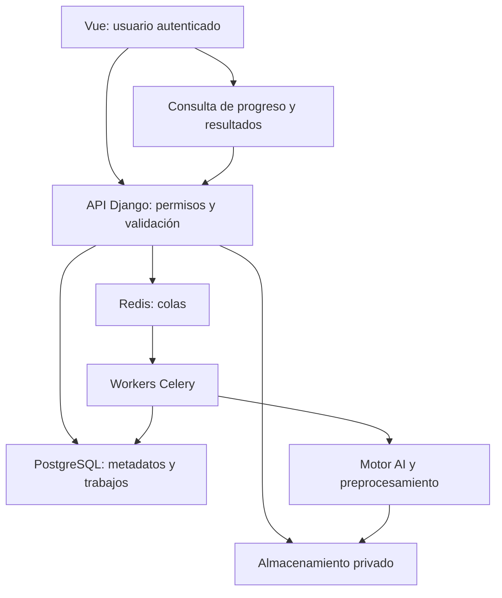
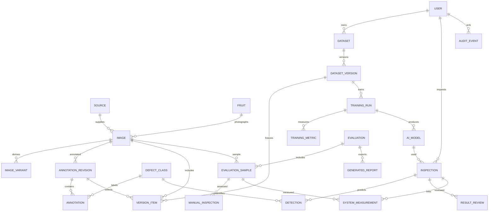

# Fase 01 — Arquitectura y planificación
Estado: propuesta para revisión; sin migraciones ni detector implementados.
Proyecto: Sistema basado en YOLO para detectar roña superficial en paltas Hass, Lambayeque, 2026.

## 1. Decisiones de arquitectura
Se aprueba Vue 3 + TypeScript y Django REST Framework como aplicaciones independientes en un monorepositorio. Django será un monolito modular; el motor AI será un paquete Python sin dependencias de HTTP. No se necesitan microservicios inicialmente.
PostgreSQL almacena metadatos y relaciones. Los originales, derivados, anotaciones exportadas y pesos viven en almacenamiento privado, con claves y hashes registrados en BD. Redis coordina tareas; PostgreSQL conserva su estado durable.
Celery tendrá colas training, preprocessing e inference. Un worker training por GPU, concurrencia 1, junto con reserva exclusiva del recurso: la concurrencia sola no evita que otro worker use la misma GPU. Inferencia no comparte ese recurso durante entrenamiento sin una política de capacidad medida.
No se instalará PyTorch en el proceso web por necesidad: imágenes de runtime web y AI separadas. El worker conserva en memoria el modelo por versión; un cambio de modelo no altera trabajos ya creados.

## 2. Requisitos y aceptación
| ID | Requisito funcional | Aceptación |
|---|---|---|
| RF01 | JWT, usuarios, perfil, roles y auditoría | Solicitudes anónimas rechazadas; investigador sin permiso no administra usuarios ni promueve modelos |
| RF02 | Datasets, versiones, fuentes, frutos e imágenes | Original inmutable, hash, dimensiones y fuente registrados; duplicados informados |
| RF03 | Importación múltiple y ZIP | Se rechazan rutas relativas peligrosas, enlaces, exceso de archivos/bytes y contenido incompatible |
| RF04 | Anotaciones y revisión humana | Cajas dentro de imagen; negativos revisados sin cajas; autor y revisor distintos cuando protocolo lo exija |
| RF05 | Preprocesamiento reversible | Se crea derivado con receta y transformación de cajas, conservando original; relleno constante, sin inventar fruto |
| RF06 | Partición y exportación YOLO | Mismo fruto/grupo de similitud en una sola partición; solo anotaciones aprobadas; manifiesto reproducible |
| RF07 | Entrenar y comparar | Trabajo asíncrono con versión congelada, semilla, configuración y estado durable |
| RF08 | Registro y promoción de modelos | Pesos de procedencia confiable, hash y experimento vinculados; promoción autorizada y auditable |
| RF09 | Inferencia individual/lote/foto | Archivo validado; modelo y umbral fijados; cero detecciones es resultado válido, nunca diagnóstico sano |
| RF10 | Historial y revisiones | Resultado original preservado; correcciones humanas separadas de predicción |
| RF11 | Dashboard y exportaciones | Solo datos reales o fixtures explícitos; filtros consistentes entre pantalla y exportación |
| RF12 | Evaluación experimental | Mismas muestras, referencia independiente, tiempos y protocolo identificados; métricas calculadas, no inventadas |

| ID | Requisito no funcional | Verificación |
|---|---|---|
| RNF01 | Seguridad | Permisos en API y archivos, secretos fuera de git, HTTPS en producción, CORS explícito |
| RNF02 | Reproducibilidad | Versiones exactas, commit, hashes, seed, hardware y manifiestos guardados |
| RNF03 | Integridad | FK protegidas, restricciones de rango, transacciones y versiones congeladas |
| RNF04 | Rendimiento | Medir p50/p95 y memoria en hardware identificado; no prometer 50 ms sin medición |
| RNF05 | Disponibilidad | Tareas idempotentes, reintentos limitados, recuperación de trabajos abandonados, copias y restauración probada |
| RNF06 | Mantenibilidad | Capas API/servicios/AI, contratos OpenAPI y pruebas críticas |
| RNF07 | Usabilidad | Layout responsivo, estados vacíos, progreso, errores claros y navegación por teclado |
| RNF08 | Privacidad | Acceso privado, retención de archivos y minimización de datos personales |

El investigador administra sus datos y experimentos con permisos expresos. Solo administrador promueve modelo activo y gestiona usuarios. No hay registro público por defecto.

## 3. Flujo lógico

Carga: validar contenido y límites, guardar original, registrar fuente/fruto/hash.
Preparación: revisar, anotar, generar derivado, particionar por grupo, congelar versión.
Entrenamiento: crear trabajo, publicar después del commit con outbox/reconciliación para evitar pérdida entre BD y broker, entrenar, guardar artefactos y métricas, revisar, promover.
Inferencia: fijar modelo/umbrales, validar imagen, crear inspección, ejecutar worker, guardar cajas y tiempos, consultar resultado.
Evaluación: congelar protocolo y test, recoger inspecciones humanas independientes, evaluar muestras compartidas y exportar evidencia.

## 4. Módulos y responsabilidades
| Ruta backend/apps | Responsabilidad |
|---|---|
| accounts | Usuario personalizado desde la primera migración, permisos y perfil |
| datasets | Fuentes, frutos, archivos, versiones, partición y manifiestos |
| annotations | Revisiones y cajas humanas; importación/exportación |
| preprocessing | Recetas, derivados y trabajos de imagen |
| training | Experimentos, métricas, recursos y registro de modelos |
| detection | Coordinación de inferencia y adaptación de salidas AI |
| inspections | Historial, cajas predichas y revisiones |
| evaluation | Protocolos, muestras, sesiones manuales y resultados experimentales |
| reports | Agregados y exportaciones |
| core | Auditoría, contratos de trabajos, errores y utilidades comunes |

ai/ contiene entrenamiento, inferencia, preprocesamiento y evaluación reutilizables; no importa vistas ni requests de Django.
Los servicios aplican reglas y transacciones; serializers validan contratos; views coordinan HTTP sin cargar modelos.

## 5. Modelo entidad-relación propuesto
Todas las entidades mutables llevan UUID, created_at y updated_at; actores por FK cuando corresponda. Archivos identificados por clave privada y SHA-256. Lo siguiente es diseño, no tablas existentes.


| Entidad | Campos principales y restricciones |
|---|---|
| User | username único, email, rol, activo; AbstractUser personalizado |
| Source | nombre, tipo, licencia/permiso, URL, fecha; sin asumir derechos por ser pública |
| Fruit | código único, lote, procedencia, grupo_particion; identidad desconocida requiere agrupar sesión/lote conservadoramente |
| Image | source_id, fruit_id, storage_key, sha256, ancho/alto >0, bytes, estado gestión, autor |
| ImageVariant | image_id, storage_key, receta JSON versionada, matriz/escala/padding, hash |
| Dataset | nombre, descripción, propietario |
| DatasetVersion | dataset_id, número, estado draft/frozen, seed, proporciones, manifest_hash; unique(dataset,número) |
| VersionItem | version_id, image_id, annotation_revision_id, variant_id opcional, split; unique(version,image); referencia a snapshot aprobado |
| DefectClass | código estable, nombre, activo; inicialmente código 0, nombre rona |
| AnnotationRevision | image_id, número, estado, autor, revisor, revisión anterior; al aprobar se vuelve inmutable |
| Annotation | revision_id, class_id, xc,yc,w,h normalizados; w/h>0 y caja completa dentro de [0,1] |
| TrainingRun | versión frozen, solicitante, modelo base/hash, config JSON, seed, estado, job_id, commit, entorno/hardware, inicio/fin/error |
| TrainingMetric | run_id, época, split, nombre, valor; unique(run,época,split,nombre); NULL significa no medido |
| AIModel | run_id, pesos_key/hash, arquitectura, estado candidate/approved/retired, aprobador; configuración activa con FK única al modelo |
| Inspection | usuario, input_key/hash, modelo PROTECT, configuración, job_id, estado, inference_ms, total_ms, revisión; tiempos >=0 o NULL |
| Detection | inspection_id, clase, confianza [0,1], caja y sistema de coordenadas documentado |
| ResultReview | inspección, revisor, decisión, observación, correcciones JSON versionadas; nunca sobrescribe detecciones |
| Evaluation | nombre, protocolo/version, versión test frozen, modelo, umbrales, criterio fruto, plan estadístico, estado |
| EvaluationSample | evaluation_id, image_id, fruit_id, revisión de referencia fijada; unique(evaluation,image) |
| ManualInspection | sample_id, participante seudónimo, sesión, repetición, decisión, elapsed_ms, orden; sin acceso a predicción/referencia |
| SystemMeasurement | sample_id, inspection_id, repetición, hardware, tiempos de inferencia y extremo a extremo |
| GeneratedReport | evaluación opcional, usuario, filtros, archivo, hash, fecha |
| AuditEvent | actor, acción, entidad/id, metadatos mínimos, fecha; append-only |

Índices: Image(sha256), Image(fruit_id), VersionItem(version_id,split), TrainingRun(estado,created_at), Inspection(usuario,created_at), Inspection(modelo,estado).
No borrar versiones, modelos ni referencias usadas en experimentos: PROTECT y archivado.
SHA-256 puede repetirse entre fuentes: se deduplica almacenamiento sin perder procedencia. Una relación adicional de procedencias se añadirá si una imagen tiene varias fuentes.
Validaciones de misma imagen entre anotación/derivado/VersionItem requieren servicio transaccional y pruebas; FK aisladas no garantizan esa coherencia.
El grupo de partición se asigna de forma indivisible: todos los frutos enlazados por similitud pertenecen al mismo grupo. Una versión frozen conserva archivos, etiquetas, clase y split mediante manifiesto/hash; no solo FK a objetos editables.
Negativo confirmado: revisión aprobada sin cajas. Pendiente sin cajas no equivale a negativo.

## 6. Estructura definitiva propuesta
```text
frontend/
  src/
    assets/ components/ layouts/ views/
    router/ stores/ services/ composables/ types/
  package.json
  package-lock.json
  vite.config.ts
backend/
  manage.py
  config/
    settings/              # base, development, test, production
    urls.py
    celery.py
    asgi.py
    wsgi.py
  apps/
    core/ accounts/ datasets/ annotations/ preprocessing/
    training/ detection/ inspections/ reports/ evaluation/
  ai/
    training/ inference/ preprocessing/ evaluation/
  tests/
  requirements/
    base.in
    web.in
    ai.in
    dev.in
    locks/
docker/
  web.Dockerfile
  worker.Dockerfile
docs/
  fase-01-arquitectura.md
  api/
  adr/
scripts/
storage/                    # ignorado: originales, derivados, pesos, exports
compose.yaml
.env.example
.gitignore
README.md
```
Cada app tendrá models, services, serializers, permissions, views, urls, migrations y tests cuando se implemente. No crear endpoints vacíos. Los pesos no forman parte del código fuente.
Mantener .env.example sin secretos; ignorar .env, venv, node_modules, dist, storage, modelos y datasets. No versionar imágenes privadas ni checkpoints grandes.

## 7. Base tecnológica y verificación pendiente
| Componente | Línea propuesta |
|---|---|
| Python | 3.12, último parche compatible disponible |
| Django | 5.2 LTS, último parche de seguridad de la serie |
| DRF | 3.16.x como candidato; resolver y comprobar con Django 5.2 |
| PostgreSQL / driver | 17.x / psycopg 3.x, a resolver |
| Node | 22 LTS, mínimo 22.12 para Vite; usar parche mantenido |
| Vue / TypeScript | Vue 3.x / TypeScript compatible con plantilla Vue |
| Vite / Tailwind | versión estable de plantilla validada / Tailwind 4.x candidata |
| Pinia / Router / Axios | versiones compatibles a fijar con lockfile |
| Celery / Redis | Celery 5.x / Redis 7.x candidatos; verificar soporte/licencia del despliegue |
| Ultralytics | paquete compatible fijado; arquitectura explícita yolov8n.pt o yolov8s.pt |
| PyTorch / torchvision | pareja oficial compatible con Python 3.12 y CPU/CUDA del equipo |
| OpenCV / Pillow / NumPy | headless para workers, versiones resueltas junto con Ultralytics |
| Pandas / sklearn | versiones compatibles en runtime evaluación |
| JWT / OpenAPI | SimpleJWT y drf-spectacular compatibles, a verificar |

No se declara una instalación verificada: Fase 1 no instala dependencias. No confundir versión del paquete ultralytics con arquitectura YOLOv8. Los parches exactos y hashes se congelan en Fase 2 tras resolver, pip check, django check, pruebas y build Vue.
Separar locks web y AI; no instalar OpenCV GUI y headless simultáneamente.
Fuentes primarias:
- https://docs.djangoproject.com/en/5.2/releases/5.2/
- https://www.django-rest-framework.org/
- https://vite.dev/guide/
- https://docs.ultralytics.com/models/yolov8/
- https://pytorch.org/get-started/locally/
- https://docs.celeryq.dev/en/stable/

## 8. Fases y criterios de cierre
| Fase | Entregable | Criterio de cierre |
|---|---|---|
| 01 Arquitectura | Este diseño, ER y decisiones | Revisión de alcance, datos, permisos y protocolo; ninguna migración aún |
| 02 Base ejecutable | Vue, Django, Postgres, Redis, Celery, JWT, layout, OpenAPI, CI | Login/permisos probados, migraciones en BD vacía, API real y build correcto |
| 03 Dataset y anotación | Importación, galería, frutos, fuentes, revisión, splits, exportación | ZIP malicioso rechazado; exportación y negativos correctos; sin fuga por fruto |
| 04 Preprocesamiento | Letterbox, ROI, calidad, derivados/lotes | Original intacto y cajas transformadas correctamente |
| 05 Entrenamiento | Workers, tracking, snapshots, modelos | Entrenamiento real reproducible y métricas/artefactos recuperables |
| 06 Inferencia | Individual, lotes, captura e historial | Cero detecciones, fallos y resultados reales probados; tiempos medidos |
| 07 Reportes | Dashboard, filtros, PDF/Excel | Agregados coinciden con BD y exportaciones |
| 08 Evaluación | Test independiente, manual vs sistema, estadísticas | Protocolo ejecutado, evidencia exportable y análisis justificable |
| 09 Entrega | Hardening, manuales, despliegue y restauración | Pruebas críticas, manuales y copia restaurada verificados |

Dependencias: 03 depende de 02; 04 de 03; 05 de snapshots/revisión en 03 y transformaciones elegidas en 04; 06 de modelo validado en 05; 07 de resultados reales; protocolo 08 se diseña desde 01 y se ejecuta tras 06. La calidad y pruebas acompañan todas las fases.

Orden Fase 2: verificar entorno → resolver y bloquear dependencias → usuario personalizado → settings → servicios Compose → migraciones aprobadas → JWT/permisos → OpenAPI → Vue y layout → integración y CI.
Endpoints previstos, no implementados: /api/v1/auth/token/, auth/token/refresh/, auth/logout/, users/me/, datasets/, images/, annotations/, preprocessing/, training-runs/, models/, inspections/, evaluations/, reports/.
Crear trabajo: POST devuelve 202 y recurso/estado; consulta GET; errores 400/401/403/404/409/413/415 según caso, paginación en listas. Detection representa el servicio; las cajas son recursos hijos de inspección para evitar dos historiales distintos.
Logout invalida refresh; access corto sigue vigente hasta expirar salvo estrategia adicional. Definir almacenamiento de tokens antes de implementar; preferir refresh cookie HttpOnly/Secure con CSRF y access en memoria.

## 9. Riesgos y mitigaciones
- Datos insuficientes/etiquetado incorrecto: curación y revisión especializada; no fijar metas como resultados.
- Fuga de datos: agrupar por fruto, sesión y similitud antes de particionar; augmentación solo train.
- Test usado para elegir modelo: selección con validación, test reservado; registrar accesos y protocolo.
- Ausencia de lesión visible: resultado sin detecciones, no confirmación de sanidad.
- Cajas de roña no equivalen a severidad: no reportar porcentaje de superficie sin segmentación y validación específica.
- Foto única no cubre superficie completa: delimitar a cara visible o protocolo multivista por fruto.
- Hardware limitado: baseline yolov8n, colas separadas; registrar latencia y hardware.
- Tareas duplicadas/fallo broker: idempotencia por job y reconciliación/outbox; evitar reintentos ciegos de entrenamientos.
- ZIP bomba/archivos corruptos: límites de compresión, bytes expandidos, cantidad, dimensiones y decodificación.
- Pesos .pt no confiables: solo artefactos internos/permitidos y hashes; no subida pública de modelos.
- Versiones cambiantes: locks e imagen reproducible; verificar compatibilidad de CUDA antes de instalar.
- Comparación humana injusta: mismas muestras, orden aleatorio, cegamiento y tiempos equivalentes.
- Pseudorreplicación: varias fotos del mismo fruto no son observaciones independientes; análisis por fruto o modelo agrupado.
- Hipótesis ambigua: fijar qué significa precisión (precision vs accuracy), criterio fruto y unidad de tiempo antes de probar.
- Estadística incorrecta: selección según diseño pareado/agrupado, intervalos de confianza y tamaño muestral; no decidir solo por normalidad.
- Licencias: verificar datos, pesos y dependencias antes de distribución.
- Sobrealcance: cámara continua, GAN y nuevas clases quedan fuera del MVP.

## 10. Primeros comandos (Fase 2, después de revisar el ER)
Ejemplo PowerShell en Windows. No ejecutados en esta fase.
```powershell
git clone https://github.com/mechananthony22/ProyectoTesis__Yolo.git
cd ProyectoTesis__Yolo
git switch -c feat/fase-02-base
py -3.12 --version
node --version
npm --version
docker compose version
py -3.12 -m venv .venv
.venv\Scripts\Activate.ps1
python -m pip install --upgrade pip
python -m pip install "Django>=5.2,<5.3" "djangorestframework>=3.16,<3.17" "psycopg[binary]>=3,<4"
mkdir backend
django-admin startproject config backend
npm create vue@latest frontend
```
Seleccionar TypeScript, Router, Pinia y herramientas de pruebas en el asistente. Antes de migrar: configurar PostgreSQL, settings separados y AUTH_USER_MODEL; crear apps accounts/core y revisar esquema.
```powershell
python -m pip check
python backend/manage.py check
cd frontend
npm install
npm run type-check
npm run build
```
Estos comandos iniciales no completan la Fase 2. Incorporar JWT, CORS, OpenAPI y Celery después de validar sus versiones; generar locks y pruebas antes del cierre. PyTorch se instala en worker según selector oficial CPU/CUDA, no mediante una receta GPU asumida.

## Revisión de Fase 01
Revisar: unidad experimental fruto/multivista, roles y promoción, fuentes/licencias, snapshots y partición, hardware de entrenamiento/inferencia.
Pendiente: revisión y confirmación del diseño. No existen métricas reales, API funcional ni migraciones por esta entrega.

